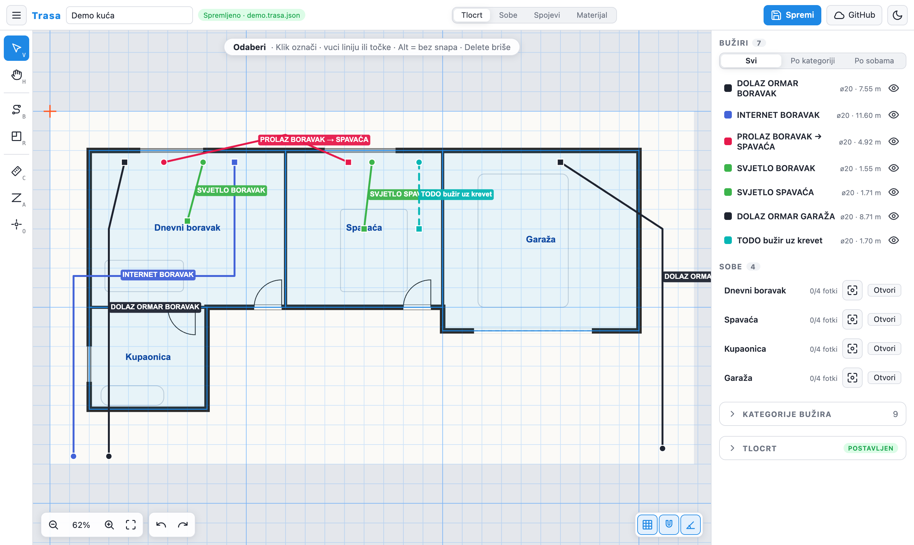
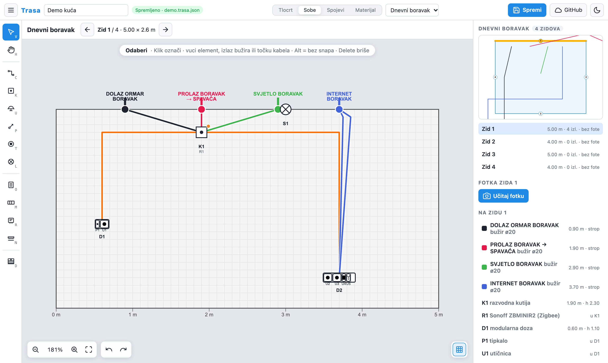
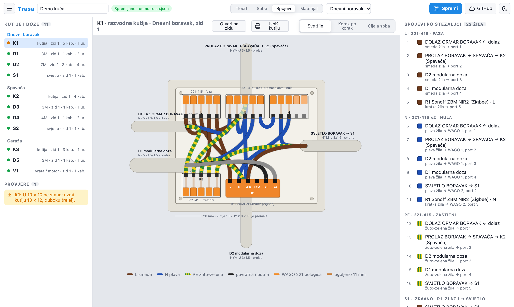
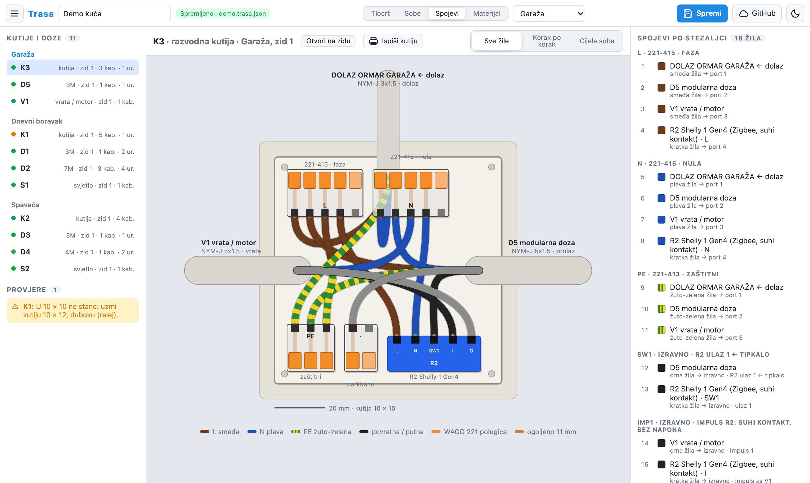
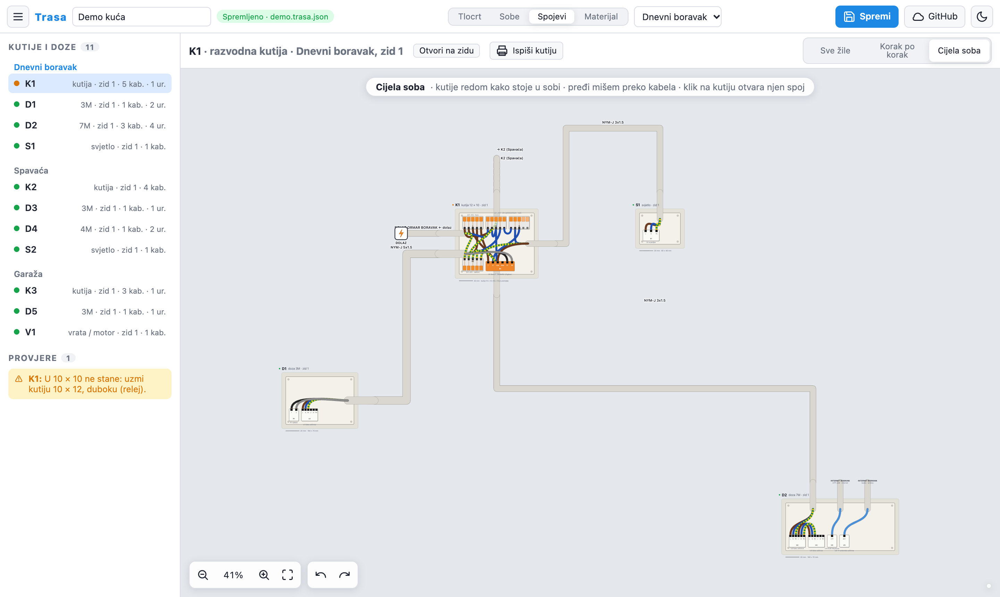
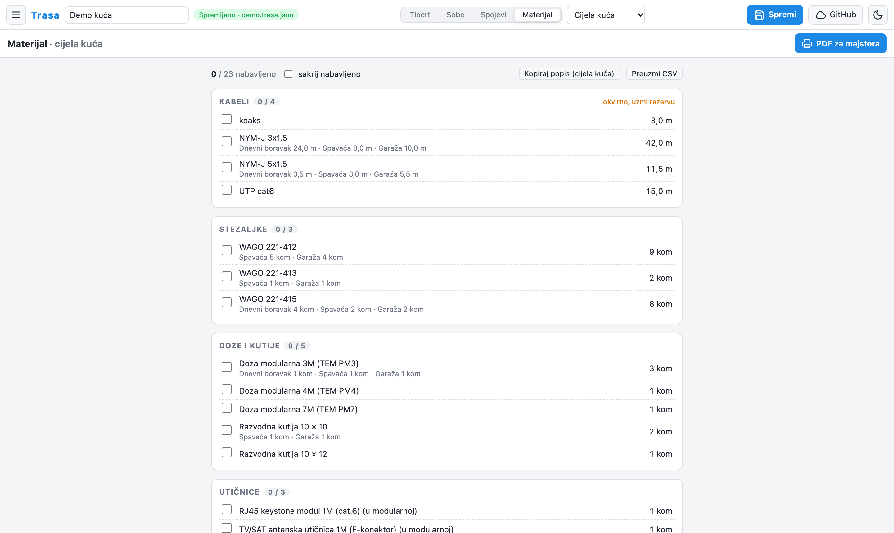
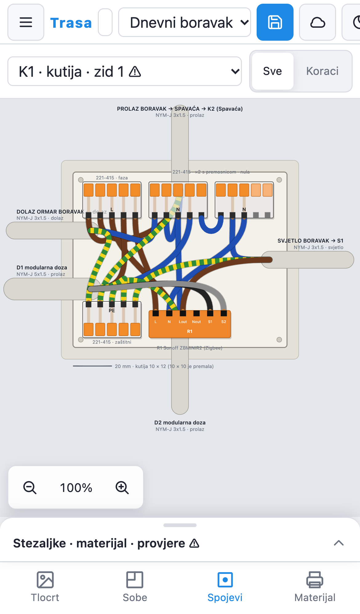

<div align="center">


**Planer bužira, razvodnih kutija i spojeva za kuću.**<br>
Nacrtaš trase na tlocrtu i elemente na zidu, a Trasa izvede koje žile idu u koji WAGO, koju kutiju kupiti i koliko kabela treba.

[](https://trasa.trasa-auth.workers.dev/)
[](docs/UPUTE.md)




</div>

## Sadržaj

- [Što radi](#što-radi)
- [Brzi početak](#brzi-početak)
- [Prečaci](#prečaci)
- [Spremanje i privatnost](#spremanje-i-privatnost)
- [Tehnologija](#tehnologija)
- [Plan](#plan)

## Što radi

<table>
<tr>
<td width="50%" valign="top">

### Tlocrt i bužiri
Učitaš sken tlocrta, postaviš mjerilo i nacrtaš sobe i trase bužira kroz deku. Bužiri imaju kategorije (dolaz, rasvjeta, internet, TODO…) i duljine u metrima.

</td>
<td width="50%"></td>
</tr>
<tr>
<td></td>
<td valign="top">

### Zid po zid
Svaki zid je editor na fotki zida: razvodne kutije, modularne doze, utičnice (šuko, euro, RJ45, TV), prekidači po IEC simbolima, releji, svjetla, vrata, KIP. Kabeli se vuku od izlaza bužira do elemenata i nastavljaju oko kuta.

</td>
</tr>
<tr>
<td valign="top">

### Spoj svake kutije u mjerilu
Iz nacrtanog izvede ulogu svakog kabela i složi žile na stezaljke: WAGO 221-412/413/415 u pravim dimenzijama, premosnice iznad 5 žila, boje po HD 308. Kutija sama naraste na pravu veličinu iz ljestvice kutija koje se prodaju u Hrvatskoj.

</td>
<td></td>
</tr>
<tr>
<td></td>
<td valign="top">

### Pametna rasvjeta i vrata
Sonoff ZBMINIR2 i Shelly 1 Gen4 s pravim stezaljkama. Tipkala na releju, izlaz na svjetlo, Shelly kao suhi kontakt za garažna vrata. Signali putuju kroz lanac kutija najkraćim putem, a aplikacija kaže kad kabel treba 5×1,5 ili 7×1,5.

</td>
</tr>
<tr>
<td valign="top">

### Cijela soba na jednoj shemi
Sve kutije i doze sobe poredane kako stoje, u tri reda po visini, s pravim plaštevima kabela između njih. Prijelaz mišem osvijetli žile na oba kraja.

</td>
<td></td>
</tr>
<tr>
<td></td>
<td valign="top">

### Materijal i PDF za majstora
Popis za kupnju po grupama, s podjelom po sobama, kvačicom "nabavljeno", kopiranjem i CSV-om. PDF ispis po sobi i A4 list za svaku kutiju.

</td>
</tr>
</table>

<table>
<tr>
<td width="280"></td>
<td valign="top">

### Mobitel = terenski način
Na gradilištu: donja traka, sheetovi koji se povlače odozdo, pinch zoom na spoju kutije i kamera za fotke zidova. Crtanje ostaje na računalu.

### Provjere
Kutija bez dolaza, premalo žila u kabelu, relej bez nule ili u plitkoj dozi, prekidač bez svjetla, presjeci uzemljenja po HD 60364-5-54, doza pretijesna za module.

</td>
</tr>
</table>

## Brzi početak

Zahtjevi: Node 20+, pnpm 9+.

```sh
pnpm install
pnpm dev          # http://localhost:5173
```

| Naredba | Što radi |
|---|---|
| `pnpm typecheck` | TypeScript provjera |
| `pnpm e2e` | Playwright smoke test protiv `pnpm dev --port 5177` (lokalni Chrome) |
| `pnpm shots` | ponovno slika screenshotove u `docs/img` na izmišljenoj demo kući |
| `pnpm run deploy` | build + `wrangler deploy` na Cloudflare Workers |

Detaljne upute za rad: **[docs/UPUTE.md](docs/UPUTE.md)**.

## Prečaci

| Tlocrt | | Zid | |
|---|---|---|---|
| <kbd>V</kbd> odaberi | <kbd>H</kbd> pomakni | <kbd>C</kbd> kabel | <kbd>K</kbd> razvodna kutija |
| <kbd>B</kbd> bužir | <kbd>R</kbd> soba | <kbd>M</kbd> modularna doza | <kbd>U</kbd> utičnica |
| <kbd>C</kbd> mjerilo | <kbd>A</kbd> poravnaj | <kbd>P</kbd> prekidač | <kbd>T</kbd> tipkalo |
| <kbd>O</kbd> ishodište | <kbd>Alt</kbd> bez snapa | <kbd>R</kbd> relej | <kbd>L</kbd> svjetlo |
| <kbd>⌘</kbd> <kbd>S</kbd> spremi | <kbd>⌘</kbd> <kbd>Z</kbd> undo | <kbd>D</kbd> vrata / motor | <kbd>Z</kbd> KIP uzemljenje |

## Spremanje i privatnost

- **Lokalno:** projekt se automatski sprema u IndexedDB preglednika. **Spremi** (<kbd>⌘</kbd> <kbd>S</kbd>) piše `.trasa.json` (u Chromeu uvijek u istu datoteku), **Otvori** je vraća.
- **GitHub:** gumb **GitHub** sprema projekt i fotke u `projects/<slug>/` ovog repoa. Prijava ide preko Cloudflare Workera u [`auth-worker/`](auth-worker) (GitHub App, pravo Contents: write; tokeni ostaju na uređaju).
- **Šifriranje:** s upisanom lozinkom sve se šifrira na uređaju (AES-GCM, PBKDF2) i sprema kao `.enc`. **Bez lozinke datoteke idu u repo nešifrirane**, a repo je javan.

## Tehnologija

| | |
|---|---|
| UI | React 18, TypeScript, Vite |
| Platno | react-konva (tlocrt, zidovi), SVG (spojevi, shema sobe, ispis) |
| Stanje | zustand + zundo (undo/redo), idb-keyval |
| Hosting | Cloudflare Workers static assets, OAuth worker u `auth-worker/` |
| Testovi | Playwright smoke suite (`e2e/smoke.mjs`), desktop i iPhone 14 |

```
src/
  junction.ts     engine: uloge kabela, signali, stezaljke, veličina kutije, provjere
  bom.ts          popis materijala
  walls.ts        geometrija zidova i izlaza bužira
  store.ts        zustand store, migracije starih save-ova
  components/     PlanCanvas, WallCanvas, JunctionCanvas, RoomScheme, MaterialView, Print*…
e2e/              smoke.mjs (testovi), screenshots.mjs (slike za README)
docs/             UPUTE.md, img/
```

## Plan

- [ ] Strujni krugovi: osigurači, snaga po krugu, faze, tablica ormara
- [ ] 24 V strana LED niše (RGBW PM) u slici spoja
- [ ] Ispravljanje perspektive fotke zida (4 kuta → pravokutnik u metrima)
- [ ] Checklist izvedbe po kutiji

<div align="center"><sub>Napravljeno za vlastitu kuću · <a href="https://trasa.trasa-auth.workers.dev/">trasa.trasa-auth.workers.dev</a></sub></div>
